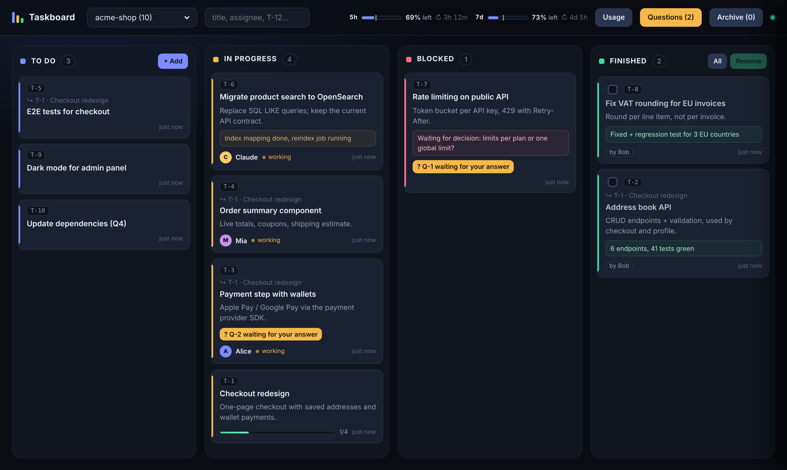
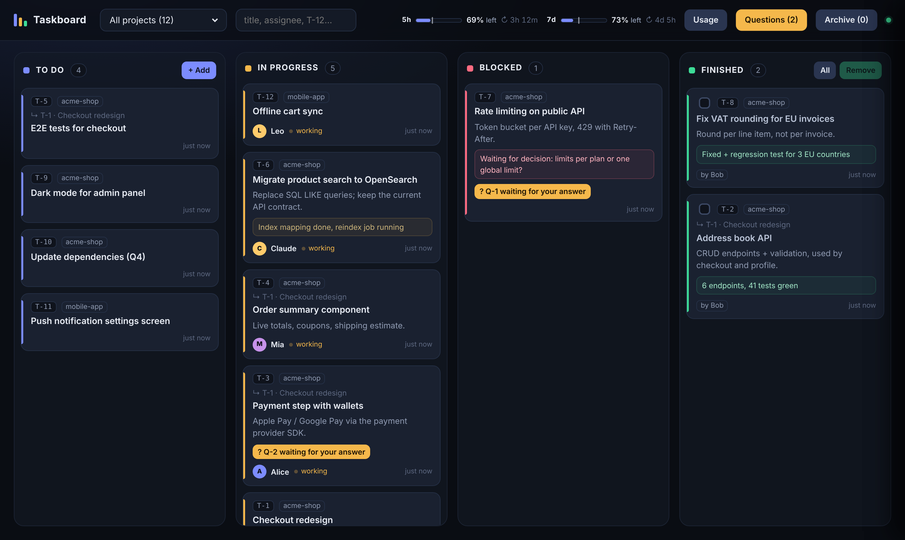
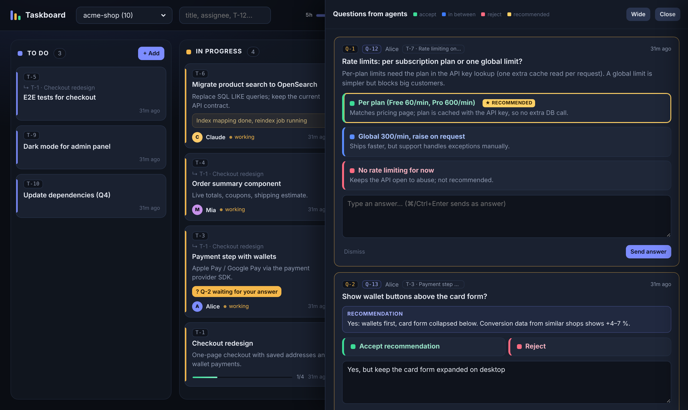
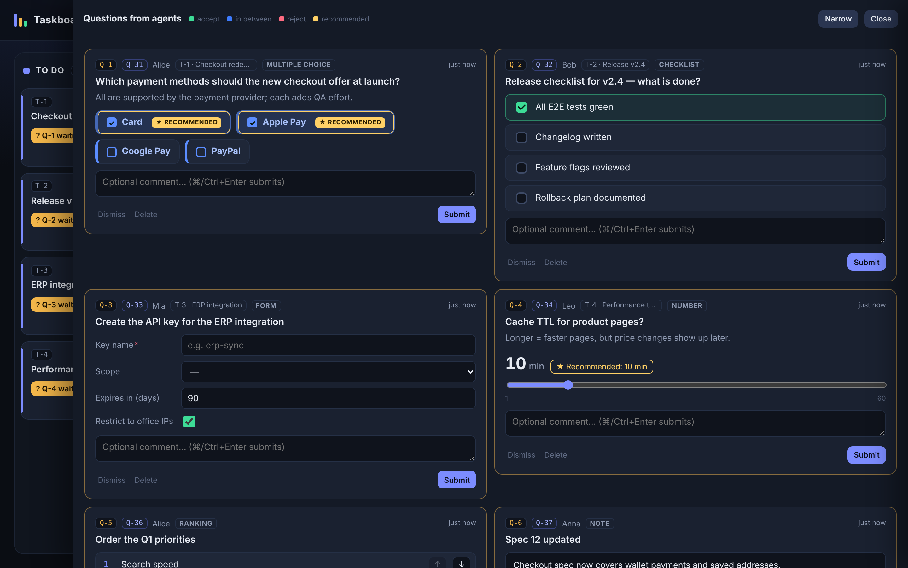
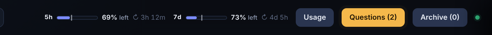
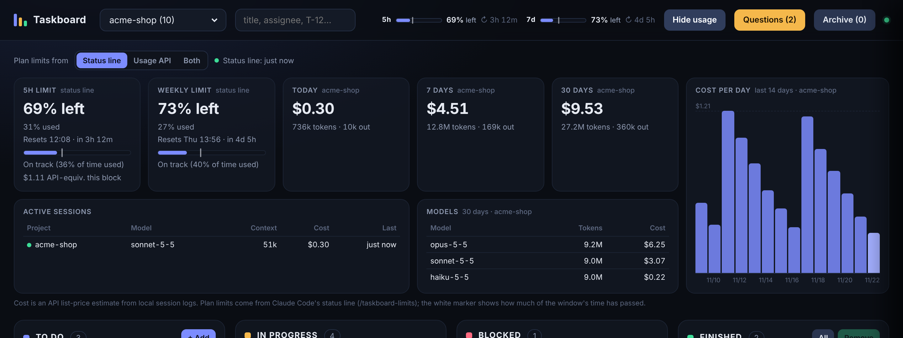

# Claude Taskboard

**A live, dark-mode kanban board for Claude Code agents.** Agents plan big implementations as
cards, split work into subtasks, show who is working on what, ask you questions you answer in the
browser, and keep an eye on your token usage and plan limits.

It runs **only while Claude Code runs**: no daemon, no global server, no account, no npm install.



---

## Contents

- [Features](#features)
- [Install](#install)
- [Quick start](#quick-start)
- [Working with the board](#working-with-the-board)
- [Questions from agents](#questions-from-agents)
- [Usage and plan limits](#usage-and-plan-limits)
- [How it works](#how-it-works)
- [Commands and agent tools](#commands-and-agent-tools)
- [Configuration](#configuration)
- [Troubleshooting](#troubleshooting)
- [Security and privacy](#security-and-privacy)
- [Project layout](#project-layout)
- [License](#license)

## Features

- **Kanban for agent work**: To Do · In Progress · Blocked · Finished, live in the browser.
- **Plans with subtasks**: big tasks are split into subtasks; parent cards show progress and
  finish automatically.
- **Who is working on what**: each card in progress shows its worker (e.g. *Bob*, *Alice*, or a
  named subagent) and what they are doing.
- **One board for all projects**: tasks are grouped by git repository, with a project filter.
- **Questions you answer in the UI**: agents push open questions with a recommendation and
  options; you click **Accept**, **Reject**, an option, or type an answer. The agent gets it
  automatically.
- **Usage and limits at a glance**: 5-hour and weekly plan limits in the header, plus token usage
  and API-equivalent cost per day, project and model.
- **Zero setup**: plain Node.js, no dependencies. Works with several Claude Code sessions at once.

## Install

Requires [Claude Code](https://code.claude.com) and **Node.js 18+** on your `PATH`.

In Claude Code:

```
/plugin marketplace add Ragin-LundF/claude-taskboard
/plugin install taskboard@taskboard-marketplace
```

Or from a terminal:

```bash
claude plugin marketplace add Ragin-LundF/claude-taskboard
claude plugin install taskboard@taskboard-marketplace
```

Restart your Claude Code sessions. The board is available at **http://localhost:4747** while at
least one session is running.

**Update** to the latest version:

```bash
claude plugin marketplace update taskboard-marketplace
claude plugin update taskboard@taskboard-marketplace
```

then restart your sessions. Newer sessions take the board over from older ones automatically.

## Quick start

1. Open a project in Claude Code and run:

   ```
   /kanban
   ```

   The agent analyses the current work, puts it on the board as cards (split into subtasks where
   needed) and opens the board in your browser.

2. Or just ask in your own words, e.g. *"implement the billing export and track it on the
   taskboard"*.

3. Watch the board while agents work. Answer questions when the **Questions** button lights up.
   When cards are finished, tick them and click **Remove**.

## Working with the board

| Action | How |
|---|---|
| Filter by project | Project dropdown in the header (*All projects* shows everything) |
| Search | Search field: title, description, assignee or id (`T-12`) |
| Move a card | Drag it to another column |
| Add a card yourself | **+ Add** in *To Do* (pick a project first) |
| Remove finished cards | Tick them in *Finished* → **Remove**. They go to the **Archive** and can be restored |
| Delete a card | Hover → ✕ → click again to confirm |

Cards marked **auto** are mirrored automatically from an agent's own internal task list.



## Questions from agents

Agents push the questions they need answered to the board instead of only asking in the chat:
one at a time, or a whole list at once, for example from an `OPEN_QUESTIONS.md` with id,
description and recommendation.



- **Recommendation** → answer with **Accept** (green) or **Reject** (red), optionally with a
  comment or an alternative.
- **Options** have a type that sets their color: **accept** green, **reject** red, **neutral** blue
  for anything in between. The agent's recommended option is highlighted. Options with a
  description are shown as cards, for complex choices.
- **Free text** for anything else.

After you answer, the card shows **Sending…**, then **Answer saved, waiting for the agent**. When
the agent has picked it up you see **✓ received** and the question moves to the history.

Agents see your answer **right after their next step** (tool call), at the end of their turn, or
with your next message to them; an agent waiting in `board_ask` gets it immediately. This costs
**no tokens while nothing is waiting**: the board keeps a marker file only while answers wait for
pickup, and the hook checks it with a single file test (~2 ms) before doing anything else. An
agent that has already stopped can't be woken up; send it any message to hand the answer over.

The agent receives the decision together with its own question id, for example
`Q-1 [Q-12] → CHOSE: Per plan (accept) — your recommended option`, and writes it back to its
questions file if there is one.

Agents are reminded to use the board: when they write a file whose name contains *question* or
*fragen*, and when they end a turn with questions in the chat while the project has open work on
the board. Run `/kanban-questions [file]` to push questions on demand.

The panel can be resized by dragging its left edge, or switched to **Wide** (two columns).

### More answer types (A2UI)

For questions that need more than one choice or free text, agents use
[A2UI](https://github.com/a2ui-project/a2ui) v1.0 messages with the **taskboard catalog**
([`plugins/taskboard/catalog/taskboard-catalog-v1.json`](plugins/taskboard/catalog/taskboard-catalog-v1.json)).
The catalog contains only prepared, high-level components: the agent sends one component per
question with its content, and the board renders it. That keeps agent messages about as small as
a plain question (no layout tokens), and anything outside the catalog is rejected with a clear
error.



| Component | Use for | You answer with |
|---|---|---|
| Decision | pick one of typed options | option cards (green / blue / red, recommended highlighted) |
| Confirm | a recommendation | Accept / Reject (+ comment) |
| MultiChoice | pick several | toggle cards |
| Checklist | confirm points | checkboxes |
| Form | a few values at once | text, number, dropdown, yes/no fields |
| Range | a number | slider with unit and recommended value |
| DateTime | a date or time | date / time picker |
| Ranking | an order | move items up and down |
| Info | a note without an answer | **Got it** |

Example message (one surface per question, `surfaceId` = the agent's question id):

```json
{"version": "1.0", "createSurface": {
  "surfaceId": "Q-31",
  "catalogId": "https://github.com/Ragin-LundF/claude-taskboard/catalog/v1",
  "components": [{"id": "root", "component": "MultiChoice",
    "question": "Which payment methods at launch?",
    "options": [{"label": "Card", "recommended": true}, {"label": "Apple Pay"}, {"label": "PayPal"}]}],
  "metadata": {"taskId": "T-1", "askedBy": "Alice"}}}
```

Answers go back as standard A2UI `action` messages (`name`, `surfaceId`, `sourceComponentId`,
`timestamp`, `context`). To save tokens, agents receive them as one short line by default
(`SELECTED: Card, Apple Pay`); `board_answers` with `format: "a2ui"` returns the raw messages.

Board files stay compatible in both directions: older versions show these questions as plain
questions with a text field and keep the extra fields when saving.

## Usage and plan limits

The header always shows what is left of your **5-hour** and **weekly** plan limits, also when the
usage panel is hidden. The bar shows what is used, the thin marker how much of the window's time
has passed; it turns amber from 75 % and red from 90 %.



Click **Usage** for details: % left, reset time and pace ("on track", "ahead of pace",
"limit reached around 15:40 at this pace"), plus token usage and cost today, over 7 and 30 days,
per day, per model and for active sessions.



### Where the plan limits come from

Choose the source in the usage panel (**Plan limits from**):

| Source | Works in | How |
|---|---|---|
| **Status line** (default) | Claude Code in a terminal | Run **`/taskboard-limits`** once. It adds a small status-line bridge to `~/.claude/settings.json` (backed up first; an existing status line is kept and still shown). Claude Code passes your Pro/Max `rate_limits` to it with every response. |
| **Usage API** | Everywhere: chat windows (e.g. Orca), the desktop app, IDEs, the terminal | The board asks Anthropic's usage endpoint every 2.5 minutes with your Claude Code login. It tries the stored logins one after another until one is accepted: the macOS Keychain item *Claude Code-credentials* (macOS asks once), then `~/.claude/.credentials.json`, then other *Claude Code-credentials-…* Keychain items. **This endpoint is not officially documented and may change.** |
| **Both** | | Shows whichever source has the newest numbers. |

Undo the status-line setup with `/taskboard-limits remove`.

### Token usage and cost

Token usage is read from Claude Code's local session logs (`~/.claude/projects/**/*.jsonl`, last
35 days). Cost is an **API list-price estimate**: on a subscription it shows what the same usage
would cost on the API, not what you pay. Prices can be overridden in
`~/.claude/taskboard/pricing.json`:

```json
[{ "match": "opus-5-5", "in": 4, "out": 20, "cr": 0.2, "cw": 5 }]
```

(USD per million tokens: input, output, cache read, cache write.)

## How it works

```
Claude session 1 ─ MCP server (stdio) ─┐  wins port 4747 → LEADER: state, web UI, ~/.claude/taskboard/board.json
Claude session 2 ─ MCP server (stdio) ─┤  port taken     → FOLLOWER: forwards tool calls to the leader
Claude session 3 ─ MCP server (stdio) ─┘
```

- Claude Code starts the plugin's MCP server with each session and stops it when the session
  ends. The first one to get the port serves the board; the others forward to it.
- If the leader's session ends, another session takes over within about 2 seconds and reloads the
  state from disk; the browser reconnects by itself. When the last session ends, nothing is left
  running.
- A session with a newer plugin version takes the board over from an older one automatically.
- Hooks keep the board current: they mirror agents' internal task lists, deliver your answers to
  the session that asked, and remind agents to push their questions.
- Everything is stored in `~/.claude/taskboard/board.json`.

## Commands and agent tools

**Slash commands**

| Command | What it does |
|---|---|
| `/kanban [what to plan]` | Analyse the current work, put it on the board, open the browser |
| `/kanban-questions [file]` | Push open questions from a file or the conversation |
| `/taskboard-limits [remove]` | Install (or remove) the status-line bridge for plan limits |

**Agent tools** (used automatically through the bundled skill; you can also ask for them)

| Tool | Purpose |
|---|---|
| `board_open` | Start or find the board, return its URL |
| `board_list` | List tasks of the current project (or all) |
| `board_plan` | Create many tasks at once, with nested subtasks |
| `board_add`, `board_split` | Add a task / split a task into subtasks |
| `board_start`, `board_finish`, `board_update` | Claim with an assignee, finish with a note, change status (incl. *blocked*) |
| `board_ask` | Ask one question (waits for the answer by default) |
| `board_ask_many` | Push a list of questions with ids, recommendations and typed options |
| `board_ui` | Ask with A2UI v1.0 messages and the taskboard catalog (all answer types) |
| `board_answers` | Fetch answers that have not been delivered yet |
| `board_usage` | Plan limits and token usage as text |

## Configuration

Environment variables; set them in `~/.claude/settings.json` under `"env"` so every session uses
the same values.

| Variable | Default | Purpose |
|---|---|---|
| `TASKBOARD_PORT` | `4747` | Port of the board (all sessions must use the same) |
| `TASKBOARD_HOME` | `~/.claude/taskboard` | Where `board.json` and helper files are stored |
| `TASKBOARD_MIRROR` | on | `0` stops mirroring agents' internal task lists |
| `TASKBOARD_QUESTION_NUDGE` | on | `0` stops reminding agents to push questions |
| `TASKBOARD_USAGE` | on | `0` turns off the token usage panel |
| `TASKBOARD_LIMITS_POLL_MS` | `150000` | Poll interval for the Usage API source |
| `TASKBOARD_AGENT_NAME` | `Claude <session>` | Assignee name for mirrored cards |

## Troubleshooting

**The board doesn't open.** It only runs while a Claude Code session with the plugin is running.
Check with `/mcp` that the `taskboard` server is connected, and that `node --version` is 18 or
newer.

**Port 4747 is in use.** Set `TASKBOARD_PORT` to a free port in `~/.claude/settings.json` → `env`.

**"Version mismatch" banner.** An older Claude session still serves the board. Restart your Claude
sessions once; from v1.6 on, newer sessions take over automatically.

**"limits: not connected" / "no data from Claude Code".** With the *Status line* source, only
Claude Code in a terminal delivers limits (chat windows and the desktop app don't run status
lines), and only on Pro/Max plans after the first response. Run `/taskboard-limits`, or switch to
the *Usage API* source. `~/.claude/taskboard/.statusline-debug.json` shows what the status line
receives (field names only).

**Buttons seem to do nothing.** Look for an error message in the card or at the bottom right. It
usually means the version-mismatch case above.

## Security and privacy

- The board listens on **127.0.0.1 only**. It rejects foreign `Host` headers (DNS rebinding), and
  write requests need a custom header and a same-origin `Origin`, so other websites can't change
  your board.
- Everything stays on your machine in `~/.claude/taskboard/`. Nothing is sent anywhere, except
  with the optional **Usage API** source: then your Claude Code login token is read when needed,
  kept in memory only, and sent only to Anthropic's usage endpoint.
- The status-line setup backs up `~/.claude/settings.json` before changing it.

## Project layout

```
.claude-plugin/marketplace.json      marketplace definition (this repo is the marketplace)
plugins/taskboard/
  .claude-plugin/plugin.json         plugin manifest; starts server/mcp.js with every session
  server/mcp.js                      MCP server (stdio): agent tools
  server/lib/node.js                 leader election, HTTP API, live updates (SSE), handover
  server/lib/board.js                board state and operations
  server/lib/usage.js                token usage from session logs
  server/lib/planlimits.js           Usage API source for plan limits
  server/lib/a2ui.js                 A2UI v1.0 messages, catalog validation, action messages
  catalog/taskboard-catalog-v1.json  the A2UI component catalog (JSON Schema)
  ui/index.html                      the board (single file, no build step)
  skills/taskboard/SKILL.md          how agents use the board
  commands/                          /kanban, /kanban-questions, /taskboard-limits
  hooks/                             task mirroring, answer delivery, question reminders
  scripts/                           status-line bridge and its setup
docs/screenshots/                    images for this README
```

No build step and no dependencies: edit the files and restart your Claude sessions.

## License

[MIT](LICENSE) © 2026 Ragin-LundF
